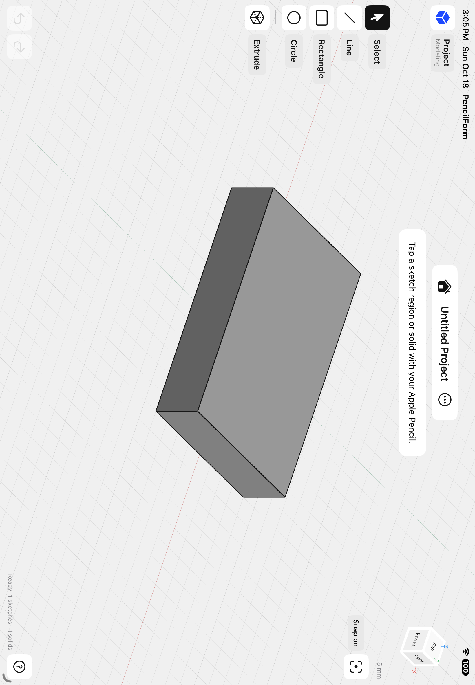

# Swipe & Sketch

Swipe & Sketch is an iPad CAD app for designing 3D-printable parts with Apple Pencil. You sketch lines, circles, rectangles, arcs, and slots on a plane or a face, dimension them, and turn them into solids with extrude, revolve, fillet, chamfer, shell, holes, threads, and boolean tools. Then you export 3MF or STL, or send the model straight to your slicer. Solids are built by the [Open CASCADE Technology](https://dev.opencascade.org) modeling kernel. An optional AI assistant, running on Apple Foundation Models, can answer questions about a model and change it.



There are no accounts. The only network service is the optional assistant's use of Apple's Private Cloud Compute.

## Status

- Version 1.0, in preparation for the App Store.
- iPad only, iPadOS 27 or later.
- **Apple Pencil is required.** The Pencil draws, selects, and drags geometry. Fingers move the view and press buttons. There is no finger-drawing mode.
- The assistant needs Apple Intelligence. Everything else works offline.

## Building

1. Build the modeling kernel once:
   ```sh
   Scripts/build_kernel.sh
   ```
   It clones Open CASCADE 8.0.1 (tag `V8_0_1`) into `build/occt/src`, builds it for iPadOS, the iPadOS simulator, and macOS, and wraps it with the app's C facade into `Vendor/SSKernel.xcframework`. The first run takes about 25 minutes. `Scripts/build_kernel.sh --facade` later rebuilds only the facade.
2. Open **SwipeAndSketch.xcodeproj** in Xcode 27.
3. Select the **SwipeAndSketch** target. Under **Signing & Capabilities**, choose your own team and a bundle identifier of your own.
4. **Private Cloud Compute:** the app's entitlements file requests `com.apple.developer.private-cloud-compute`. If your team doesn't have that entitlement, remove it from `SwipeAndSketch/SwipeAndSketch.entitlements` (or remove the capability in Xcode). The assistant then uses the on-device model only. The app checks for the entitlement (`PrivateCloudEntitlement`) and never calls the cloud model without it.
5. Connect your iPad, trust the Mac, turn on Developer Mode if asked, choose the iPad as the run destination, and press **Run** (⌘R).

The simulator is useful for checking the interface, but Pencil input needs a real iPad.

## Relinking with a modified Open CASCADE

Open CASCADE is statically linked into the app. Its license (GNU LGPL 2.1 with the Open CASCADE exception) lets you replace it with a modified version. To build Swipe & Sketch against your own Open CASCADE:

1. Put your modified Open CASCADE source in `build/occt/src`. `Scripts/build_kernel.sh` only clones when that folder is missing, so it builds whatever is there.
2. Run `Scripts/build_kernel.sh` to rebuild the toolkits and `Vendor/SSKernel.xcframework`.
3. Build and install the app with your own signing team, as in [Building](#building).

You may modify Swipe & Sketch for your own use and reverse engineer it to debug those modifications, whatever the App Store's standard license says. See [THIRD-PARTY-NOTICES.md](THIRD-PARTY-NOTICES.md).

## Running tests

Core tests run on the Mac against the kernel's macOS slice:

```sh
swift test
```

App and UI tests run on an iPadOS 27 iPad simulator:

```sh
xcodebuild test -project SwipeAndSketch.xcodeproj -scheme SwipeAndSketch \
  -destination 'platform=iOS Simulator,name=iPad Air 11-inch (M4)' \
  -derivedDataPath build/DerivedData CODE_SIGNING_ALLOWED=NO
```

The core tests cover geometry, profiles and regions, kernel operations, dimensions, snapping, undo and redo, persistence, export, and the assistant's workbench. The hosted app tests drive the canvas's Pencil pipeline and each tool. The UI tests tap real controls. Simulator tests don't prove how the app feels with a real Apple Pencil, or that palm rejection works.

`Tools/AssistantEval` is a small command-line harness that runs sample requests against the on-device assistant model on a Mac.

## Project layout

- `SwipeAndSketch/Core`: geometry, sketches and regions, solids and their operations, templates, document persistence, and history. Also built as a Swift package (`Package.swift`) for the core tests.
- `SwipeAndSketch/App`: app lifecycle, the Home screen, the modeling session, the interface, help topics, licensing, and the assistant panel.
- `SwipeAndSketch/Assistant`: the assistant's Foundation Models layer: tools, the on-device planner, and model selection. `SwipeAndSketch/Core/AssistantWorkbench.swift` is the model layer it edits through.
- `SwipeAndSketch/Canvas`: SceneKit rendering, the camera and view cube, and Pencil-only canvas input. `KernelSceneGeometry` turns kernel solids into per-face SceneKit geometry.
- `SwipeAndSketch/Kernel`: the C facade over Open CASCADE (`SSKernel.h`). `SwipeAndSketch/Core/SolidKernel.swift` wraps it in Swift.
- `SwipeAndSketchThumbnails`: the Quick Look extension that shows project thumbnails in Files.
- `Tests`: core tests (`Tests/CoreTests`), hosted iPad tests (`Tests/AppTests`), UI tests (`Tests/UITests`), and small fixtures.
- `Scripts`: `build_kernel.sh`, plus `render_template_pictures.sh` for the template gallery's pictures.

The Xcode project is maintained by hand. Add new files to it carefully and don't regenerate it: a generator would overwrite signing, the entitlements, and the kernel link.

More about the kernel integration: [Docs/Kernel.md](Docs/Kernel.md).

## File format

Projects are `.swipesketch` files: versioned JSON with analytic geometry, stable IDs, and explicit millimeter units, saved through UIDocument. The format is described in [Docs/ProjectFiles.md](Docs/ProjectFiles.md).

## Contributing

See [CONTRIBUTING.md](CONTRIBUTING.md). To report a security problem, see [SECURITY.md](SECURITY.md).

## License

Swipe & Sketch's own source is available under the [PolyForm Shield License 1.0.0](LICENSE). You may use, study, change, and build it for any purpose except offering a product that competes with Swipe & Sketch, which includes selling or giving away builds of it. This is a source-available license, not an open-source one.

Open CASCADE Technology keeps its own license. See [THIRD-PARTY-NOTICES.md](THIRD-PARTY-NOTICES.md).

## Trademarks

"Swipe & Sketch", its logo, and its app icon are trademarks of Warren Wiens and are not covered by the license. See [TRADEMARKS.md](TRADEMARKS.md).

## Acknowledgements

This software uses [Open CASCADE Technology](https://dev.opencascade.org), licensed under the GNU LGPL 2.1 with the Open CASCADE exception.
